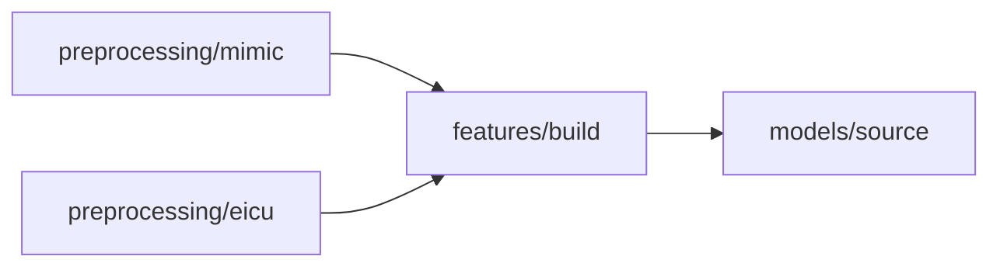

# Physiological Trajectories and Observation Patterns in ICU Mortality Prediction

ICU records describe both a patient's physiology and when and how often it was measured. This study examines the contribution of each to mortality prediction. Using the first 48 hours of records from MIMIC-III, MIMIC-IV, and eICU, it compares models based on the latest recorded values, physiological trajectories, and additional observation-pattern features.

The analyses test whether these information increments generalise across recording eras and hospitals. They also vary measurement availability and timing to assess how performance depends on the records available at prediction.

This repository produces the figures, tables, and accompanying results for the manuscript and supplement. Use Dagster to run the full study, or open individual notebooks in Jupyter to work through one analysis at a time.

## Set up the environment

Use Python 3.12 or 3.13. Run these commands from the repository root in Bash:

```sh
python3.12 -m venv .venv
.venv/bin/python -m pip install -e '.[workflow,notebooks]'
mkdir -p data
```

Replace `python3.12` with `python3.13` if needed. Dependencies and version constraints are listed in [pyproject.toml](pyproject.toml). The installation makes the `study` package in `src/` available to every notebook. Analyses use the CPU only (no GPU is required).

## Prepare the inputs

Download the original tables from PhysioNet and place them in these directories:

| Dataset | Location |
| --- | --- |
| [MIMIC-III v1.4](https://physionet.org/content/mimiciii/1.4/) | `data/mimic_iii/` |
| [MIMIC-IV v3.1](https://physionet.org/content/mimiciv/3.1/) | `data/mimic_iv/` |
| [eICU v2.0](https://physionet.org/content/eicu-crd/2.0/) | `data/eicu/` |

Each dataset requires a credentialed account, completion of the required training, and a signed data use agreement. Keep the original column names and values.

### Required tables and accepted file formats

- **MIMIC-III:** `ADMISSIONS`, `PATIENTS`, `ICUSTAYS`, `CHARTEVENTS`, `LABEVENTS`, and `OUTPUTEVENTS`
- **MIMIC-IV:** `admissions`, `patients`, `icustays`, `chartevents`, `labevents`, `outputevents`, and `omr`
- **eICU:** `patient`, `vitalperiodic`, `vitalaperiodic`, `lab`, `nursecharting`, `respiratorycharting`, and `intakeoutput`

Use `.csv` or `.csv.gz` files. Table names are matched without regard to case. Subdirectories are searched recursively, so MIMIC-IV's `hosp/` and `icu/` layout can be retained.

Dataset ZIP archives are also valid. Place `mimic_iii.zip`, `mimic_iv.zip`, and `eicu.zip` directly under `data/` instead of the corresponding directories. Each archive must contain the required CSV or CSV.gz tables. Internal subdirectories are accepted.

Set the raw data location before starting Dagster or Jupyter:

```sh
export ICU_RAW_DATA="$PWD/data"
```

Set `ICU_RAW_DATA` to the absolute path containing the dataset directories or ZIP archives. Otherwise, `run.sh` uses `data/` and standalone notebooks use `../data`.

Keep the `resources/` directory at the repository root. These files are required inputs and are not generated during a run.

```text
resources/
  feature_dictionary.csv
  mappings/
    carevue.csv
    metavision.csv
    mimiciv.csv
    eicu_events.csv
    eicu_schema.json
    shared_representations.json
```

## Run the study

From the repository root:

```sh
bash run.sh
```

Open [Dagster](http://127.0.0.1:3000), select the `study` job, and launch a run. Dagster waits for each notebook's inputs and runs independent analyses concurrently. The Runs page shows cell progress, messages, and errors.

The launcher installs the workflow dependencies and stores Dagster's history in `work/dagster/`. Each notebook runs in a fresh kernel using the workflow's Python interpreter. Executed copies are saved in `work/executed_notebooks/`, including failed cells. The source notebooks are preserved.

Run one study job at a time because all runs share the same output directories.

### Run an individual notebook

To work in JupyterLab, register the environment and start the server:

```sh
.venv/bin/python -m ipykernel install --user --name icu-mortality-prediction --display-name 'icu-mortality-prediction'
.venv/bin/python -m jupyter lab
```

Select the `icu-mortality-prediction` kernel. Run the notebook once its upstream notebooks have finished. The guide below gives the required order. Standalone runs write the same analysis outputs but do not appear in Dagster's history.

## Notebook guide

Paths below are relative to `notebooks/`. The complete workflow is declared in [src/workflow.py](src/workflow.py).

### Build the inputs

The two preprocessing notebooks can run together. Both must finish before feature creation begins:



These stages create the cohorts, observation tables, feature matrices, and source models used by the remaining notebooks.

### Run the analyses

Every notebook in this table requires `models/source`. They can run independently once the source models and predictions have been saved.

| Notebook | Produces |
| --- | --- |
| `physiology_increment/comparisons` | Physiological trajectory comparisons |
| `observation_increment/comparisons` | Observation pattern comparisons |
| `observation_counts/quantity` | Observation retention analyses |
| `observation_counts/timing` | Observation timing analyses |
| `local_eicu/training` | Local eICU models and hospital folds |
| `posthoc/learner_controls` | Alternative learners and source subsamples |
| `posthoc/source_uncertainty` | Source-refit and joint uncertainty summaries |
| `posthoc/hospital_effects` | Hospital-specific comparisons |
| `posthoc/reciprocal_transport` | Reverse-transfer comparisons |
| `posthoc/ventilation` | Restored observation-summary comparisons |

Four analyses need additional upstream results:

| Notebook | Produces | Requires |
| --- | --- | --- |
| `local_eicu/availability` | Local availability and matched-retraining results | `local_eicu/training` |
| `adaptation/local_calibration` | Local recalibration results | `local_eicu/training` |
| `adaptation/calibration` | External recalibration results | `observation_counts/quantity`, `observation_counts/timing` |
| `adaptation/pooled` | Combined score update results | `observation_counts/quantity` |

### Produce the results

The three reporting notebooks write to separate directories. Dagster launches each one when its upstream analyses have finished.

| Notebook | Writes |
| --- | --- |
| `results/figures` | PDF, SVG, and PNG figures |
| `results/tables` | CSV tables |
| `results/accompanying` | Supporting CSV files and resources |